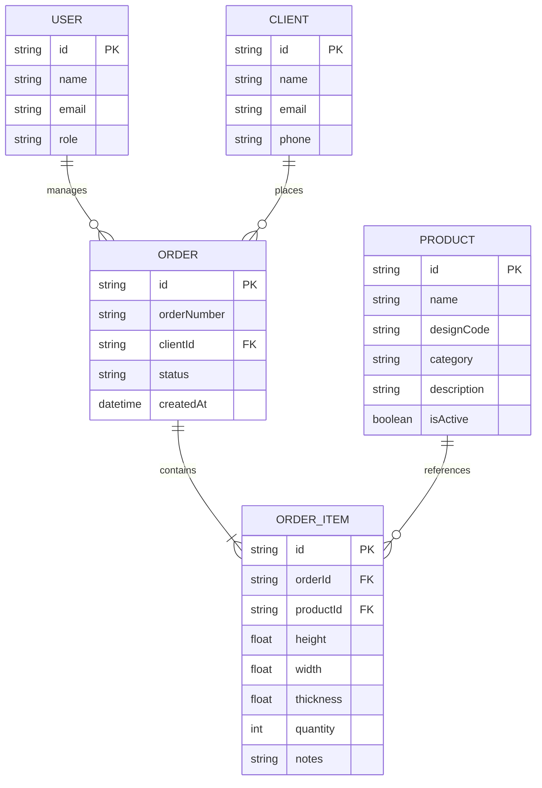
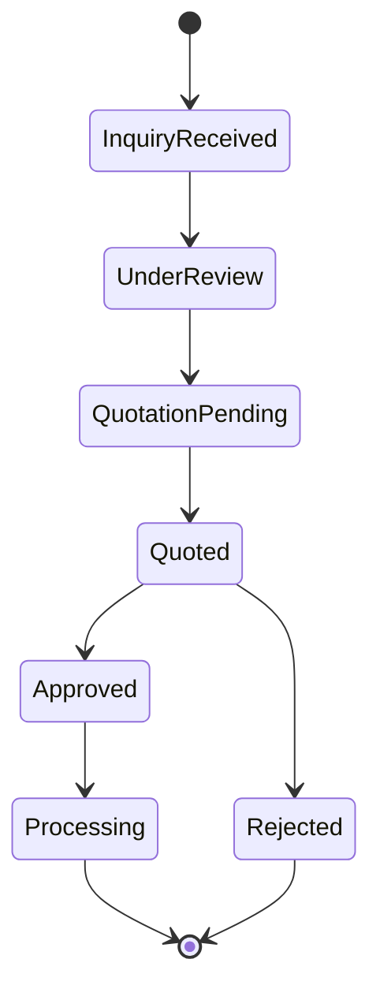
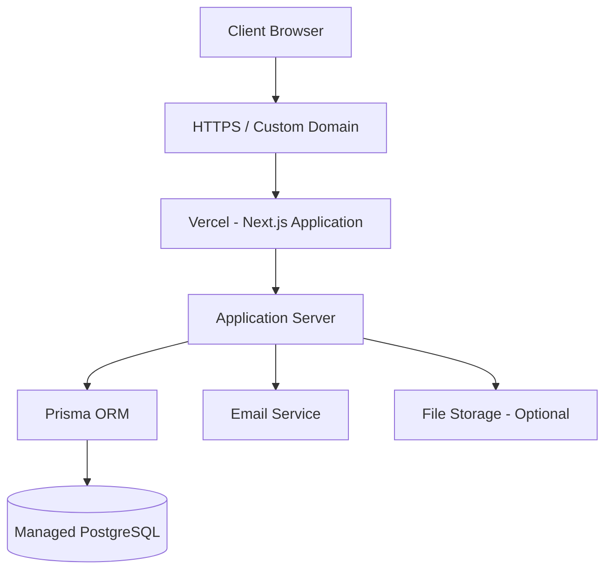
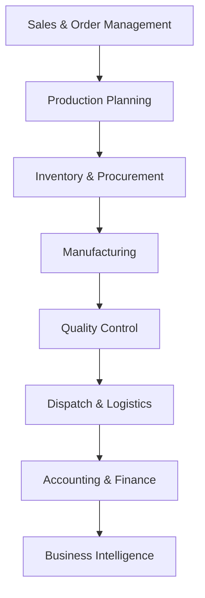

# Manufacturing Sales & Order Management System

A centralized digital sales and order management platform built for a manufacturing business, designed to streamline product discovery, capture customized client requirements, and manage incoming orders through a unified interface.

> **Project Focus:** Sales Enablement · Business Process Digitization · Order Management · Manufacturing Operations

---

## 1. Overview

Traditional sales workflows in manufacturing often rely on a combination of phone calls, WhatsApp conversations, spreadsheets, and manual documentation.

While functional, these processes become difficult to manage when dealing with customized products, varying specifications, multiple clients, and increasing order volumes.

This project digitizes that workflow by introducing a centralized platform where clients can explore product offerings, submit customized requirements, and initiate orders, while internal teams can manage and track incoming orders through a dedicated dashboard.

The objective is to reduce manual coordination, improve information accuracy, and establish a structured foundation for digitizing the company's broader operations.

## 2. Core Features

### Digital Product Catalog
- Centralized catalog of available manufacturing designs.
- Product-specific images, descriptions, and specifications.
- Categorization of products based on design and type.
- Dedicated product detail pages.
- Search and filtering capabilities.

### Client Requirement Collection
- Structured client enquiry and order forms.
- Custom dimension inputs (height, width, thickness).
- Quantity and product specification collection.
- Finish and customization preferences.
- Additional requirements and notes.

### Order Management
- Convert client inquiries into structured order records.
- Centralized order management dashboard.
- Track order information and progression.
- Maintain organized client and order records.

### Sales Workflow Management
- Simplified client-to-sales interaction.
- Reduced dependency on scattered communication channels.
- Centralized visibility into incoming requirements.
- Structured order initiation and follow-up.

---

## 3. System Architecture

The application follows a layered web application architecture, separating the presentation layer, application logic, data persistence, and external integrations.

### High-Level Architecture


### Architectural Layers

| Layer | Responsibility |
|---|---|
| Presentation Layer | Client-facing catalog, forms, and internal dashboard |
| Application Layer | Business logic, order processing, and validation |
| Authentication Layer | User authentication and access control |
| Data Access Layer | Database queries and persistence through ORM |
| Database Layer | Products, clients, requirements, and order records |
| Integration Layer | Email notifications and external services |

### Application Flow

1. A client accesses the digital product catalog.
2. The client explores available designs and specifications.
3. A product is selected and customized requirements are entered.
4. The application validates the submitted information.
5. A structured order record is created and persisted.
6. The internal team accesses the order through the management dashboard.
7. The team reviews requirements and proceeds with follow-up and order processing.

---

## 4. Database Architecture

The database is designed around the relationship between products, clients, and orders.

### Conceptual Entity Relationship Diagram



*Note: This represents the conceptual data model. Adapt entities and relationships to the actual Prisma schema.*

### Core Entities

| Entity | Purpose |
|---|---|
| User | Internal users and access management |
| Client | Customer information |
| Product | Door designs and product specifications |
| Order | Central order records |
| OrderItem | Individual products and custom requirements within an order |

The separation between orders and order items allows a single client order to contain multiple products, each with its own dimensions and specifications.

---

## 5. Order Lifecycle

The system establishes a structured transition from client enquiry to internal order handling.



This lifecycle provides a foundation for future integration with production, inventory, dispatch, and accounting workflows.

*The states shown represent the proposed extended lifecycle; actual implemented statuses may differ.*

---

## 6. Technology Stack

The following is the intended stack; retain only technologies actually used in the deployed implementation.

| Component | Technology |
|---|---|
| Frontend | Next.js |
| Language | TypeScript / JavaScript |
| Styling | Tailwind CSS |
| Backend | Next.js server-side logic / API |
| Database | PostgreSQL |
| ORM | Prisma |
| Authentication | Role-based authentication |
| Deployment | Vercel |
| Version Control | Git & GitHub |

---

## 7. Engineering Considerations

The project focuses on practical engineering challenges beyond building a conventional product catalog.

**Structured Data Management**

Transforming unstructured client communication into consistent, queryable order records.

**Data Integrity**

Capturing and validating custom manufacturing specifications to minimize errors during order processing.

**Relational Data Modeling**

Separating product, client, order, and order-item entities to support multiple products and customized specifications within an order.

**Workflow Design**

Structuring the transition from product discovery to enquiry and internal order handling.

**Scalability**

Establishing a foundation that can accommodate additional operational modules without redesigning the entire application.

**Access Control**

Separating client-facing functionality from internal business operations through appropriate authentication and authorization.

---

## 8. Deployment Architecture

The intended production deployment separates application hosting from persistent data storage.



### Deployment Components

- **Application Hosting:** Vercel or equivalent application hosting.
- **Database Hosting:** Managed PostgreSQL.
- **Domain:** Custom business domain with HTTPS.
- **Environment Configuration:** Separate development and production credentials.
- **Backups:** Scheduled database backups and recovery procedures.
- **Monitoring:** Application error logging and production monitoring.

---

## 9. Future Roadmap: Manufacturing ERP Integration

The current system serves as the foundation for a larger manufacturing operations platform.

Potential extensions include:

| Module | Planned Capabilities |
|---|---|
| Production Management | Work orders, production stages, scheduling |
| BOM Management | Raw materials, components, product configurations |
| Inventory Management | Stock tracking, material consumption, reorder levels |
| Quality Control | Inspection, rejection, and rework tracking |
| Dispatch Management | Packing lists, dispatch records, delivery tracking |
| Accounting | Invoices, payments, expenses, GST and financial reporting |
| Analytics | Sales performance, production efficiency, inventory reports |

### Long-Term Vision



The long-term objective is to evolve the platform into an integrated manufacturing ERP system connecting the company's sales, production, inventory, logistics, and financial operations.

---

## 10. Local Development Setup

### Prerequisites

- Node.js
- npm
- PostgreSQL
- Git

### Installation

Clone the repository:

```bash
git clone <repository-url>
cd <project-directory>
```

Install dependencies:

```bash
npm install
```

Configure environment variables in `.env`:

```env
DATABASE_URL="your_postgresql_connection_string"
```

Add any additional authentication, email, or storage credentials required by the implementation.

Initialize the database:

```bash
npx prisma generate
npx prisma migrate dev
```

Start the development server:

```bash
npm run dev
```

Open:

```text
http://localhost:3000
```

*Adjust the commands to match the actual project configuration and migration workflow.*

---

## 11. Project Motivation & Learnings

This project was built around an actual business workflow rather than an isolated technical exercise.

One of the most interesting aspects was understanding how manufacturing businesses handle sales differently from conventional retail businesses.

A product isn't always a fixed SKU with a fixed price. It can involve custom dimensions, material preferences, finishes, and several client-specific requirements.

That changes how the application needs to handle product configuration, data relationships, and order creation.

The project provided practical exposure to:

- Translating business requirements into software architecture.
- Designing relational data models.
- Building structured business workflows.
- Developing full-stack applications for real-world usage.
- Designing systems with future operational scalability in mind.

**The interesting engineering challenge wasn't building another e-commerce interface. It was adapting an e-commerce-style experience to the realities of custom manufacturing.**

---

## 12. Project Status

**Current Focus:** Sales and Order Management

The immediate objective is to establish a reliable, usable sales workflow for the business before progressively expanding into other operational modules.

---

*Built to solve a real business problem. Designed to grow with the business.*
